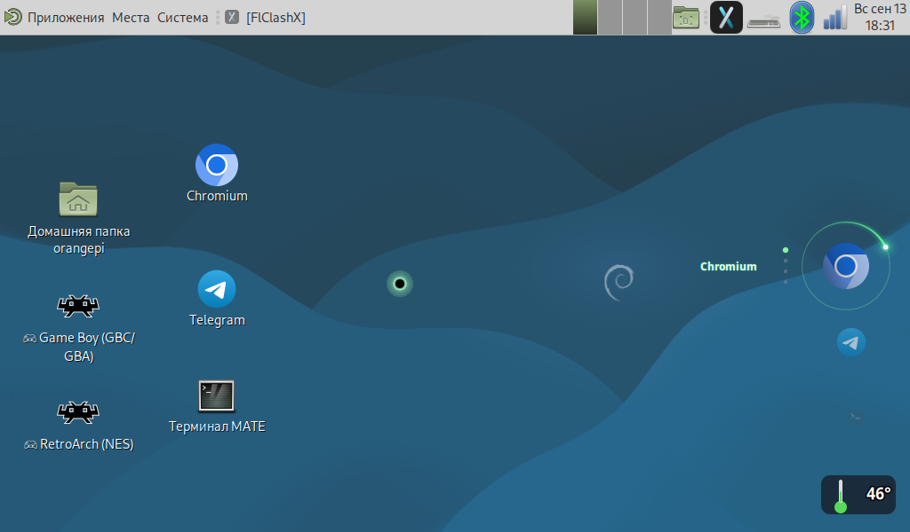

# Курсор-комета (X11 / MATE / GTK3)

Кастомный курсор с собственной отрисовкой: **чёрное ядро + светящийся ореол +
затухающий хвост**. Системный курсор при этом скрывается полностью.

Проверено на **Orange Pi Zero 3W** (Debian 13 Trixie, MATE, X11, 1024×600) и на
**Orange Pi 4 Pro** (Allwinner A733, та же система, панель 5″ по HDMI) — отличия для
второй платы в [boards/4pro.md](boards/4pro.md).



## Состав

| Файл | Назначение |
|---|---|
| `cursor-comet.py` | сам курсор: рисует комету и следует за мышью (60 fps); флаги `--hide-cursor`, `--no-xfixes` |
| `make_empty_cursor.py` | создаёт невидимую тему курсора (`comet-hidden`) |
| `autostart/cursor-comet.desktop` | автозапуск при входе в систему |
| `boards/zero3w.md` | эталонная плата: полный комплект, игровая связка |
| `boards/4pro.md` | Orange Pi 4 Pro: флаг `--no-xfixes`, почему без него шумит RandR |

## Установка

**Быстрый путь (copy-paste всех команд):** см. **[INSTALL.md](INSTALL.md)** — просто
вставляй блоки в терминал по порядку.

Ниже — что именно делается:

```bash
# 1. зависимости (Debian 13)
sudo apt install python3-gi python3-gi-cairo python3-xlib gir1.2-gtk-3.0

# 2. код
install -m 755 cursor-comet.py make_empty_cursor.py ~/.local/bin/

# 3. невидимая тема курсора
python3 ~/.local/bin/make_empty_cursor.py

# 4. автозапуск
install -Dm 644 autostart/cursor-comet.desktop ~/.config/autostart/

# 5. запуск (пока без скрытия системного — проверить, что комета следует за мышью)
~/.local/bin/cursor-comet.py

# 6. когда убедился — с автоскрытием системного курсора
~/.local/bin/cursor-comet.py --hide-cursor
```

**Откат в любой момент:** `pkill -f cursor-comet.py` — скрипт сам вернёт
системный курсор и прежнюю тему.

## Как скрывается системный курсор (три механизма)

1. **Невидимая тема курсора** `comet-hidden` — 122 прозрачных курсора,
   сгенерированных вручную в формате Xcursor. Закрывает GTK-приложения.
2. **Пустой root-курсор** (`xsetroot -cursor empty.xbm empty.xbm`) — рабочий
   стол. XFixes для этого не работает (см. грабли).
3. **Тема GNOME + MATE** (`gsettings ... cursor-theme`) — чтобы новые
   приложения подхватывали тему автоматически.

## Грабли (проверено на практике)

- **`XFixesHideCursor` не работает** на этом драйвере (`sunxi-drm`): расширение
  присутствует, но курсор не скрывается — ни для root, ни для всех окон.
  Не тратьте время: сразу делайте невидимую тему + пустой root-курсор.
- **Тема должна содержать НЕСКОЛЬКО размеров курсора** (16/24/32/48). Если
  только один — Chromium не находит нужный и рисует **свой** курсор. Именно
  это решило проблему в Chromium.
- **Панель MATE перекрывает окно курсора**, если оно управляется WM. Решение:
  `set_override_redirect(True)` (окно становится неподвластно WM) — комета
  видна поверх панели стабильно.
- **Мерцание** — если окно полноэкранное (1024×600), композитор на софт-рендере
  (llvmpipe) не успевает. Решение: окно **96×96**, следующее за курсором.
- **Окно должно быть прозрачно для кликов**: `input_shape_combine_region(
  cairo.Region(), 0, 0)` + применить в `map-event` (при realize сбрасывается).
- **Qt-приложения (Telegram)** рисуют курсор сами и игнорируют тему — там
  стрелка остаётся. На Chromium/GTK/рабочем столе всё скрывается.
- **Хвост должен затухать по времени** (TTL 0.45 с), иначе точки висят, пока
  не двинешь мышь. И перерисовывать надо даже при неподвижном курсоре.

## Проверка (объективная)

Скриншот обычным `scrot` курсор не покажет. Нужен захват с `-draw_mouse 1`:

```bash
ffmpeg -f x11grab -video_size 1024x600 -i :0 -frames:v 1 -draw_mouse 1 -y /tmp/shot.png
```

## Настройки в коде

В начале `cursor-comet.py`: `CORE_R` (ядро), `HALO_R` (ореол), `NEON` (цвет),
`TTL` (длина хвоста), `W/H` (размер окна), частота — `GLib.timeout_add(16, ...)`.

## Игровой курсор (для игр со своим курсором)

Комета хороша на рабочем столе, но в играх мешает: у неё шлейф, и диск уходит в
сторону от настоящей точки попадания — в меню выбора оружия непонятно, куда придёт
клик. Поэтому кроме кометы в репозитории лежат три скрипта, которыми управляет
сторож `game-cursor.py`:

| Файл | Что делает |
|---|---|
| `game-cursor.py` | сторож: раз в секунду смотрит, что на экране, и включает нужный режим |
| `joy-to-keys.py` | мост: движение указателя (джойстик) → клавиши цифрового блока для игрового курсора |
| `game-pointer.py` | точный прицел ровно в точке указателя (там, где клики нужны без шлейфа) |

Четыре режима:

- **рабочий стол** → комета, как обычно;
- **меню игры** → комета (ею выбирают пункты меню, клики проходят);
- **матч** (окно `hwengine`) → курсор рисует сама игра, а движение джойстика
  превращается в клавиши: игра не видит виртуально перемещённый указатель, но
  клавиши принимает;
- **игра со своим курсором** (окно `wa.exe`, Worms Armageddon) → остаётся только курсор
  самой игры: комета, прицел и мост выключаются — игра перехватывает указатель и центрует
  его, поэтому наш оверлей честно висит в центре и только сбивает с толку.

Отдельная тонкость: в матче сторож ставит файл-пометку `/tmp/m5hub-recenter`, и только при ней
драйвер джойстика (m5hub) переносит указатель в центр, когда тот доходит до края экрана — иначе
игровой курсор «упирается в стенку». На рабочем столе и в меню пометки нет, значит переноса и
прыжков курсора в центр тоже нет.

Вторая пометка — `/tmp/m5hub-direct` — ставится в режиме «игра со своим курсором». Она включает
в драйвере игровой режим стика: указатель двигается **относительно** своей текущей позиции (игра
сама центрует указатель, и абсолютный перенос она читает как прыжок «от центра до нашей точки»),
медианный фильтр выключен, скорость считается от времени (40–330 пикс/с). Разбор «догонялок»,
настройка скорости и диагностика по журналу координат — в репозитории
[`opi-zero3w-worms-armageddon`](https://github.com/Haidegger22/opi-zero3w-worms-armageddon)
(`docs/cursor-and-stick.md`).

Сторож живёт как пользовательская служба systemd с автоперезапуском — если он упадёт, служба поднимет его сама. Установка — в `INSTALL.md`, разбор граблей и
диагностика — в скилле агента `zero3w-gaming/references/hedgewars-joystick-cursor.md`.

## Другая плата: Orange Pi 4 Pro

Тот же скрипт работает и на 4 Pro, но **с флагом `--no-xfixes`**:

```bash
~/.local/bin/cursor-comet.py --hide-cursor --no-xfixes
```

Причина — не отрисовка, а вызовы XFixes. В python-xlib `window.xfixes_hide_cursor()`
на этой плате уходит в RandR-запрос к CRTC, которого нет на драйвере, и возвращает
`BadRRCrtcError (major_opcode=138, minor_opcode=29)` на каждый вызов: за 3 минуты
в отладочный файл набегало 9,2 МБ. Замер, которым это найдено:

| Что вызывается в цикле | Результат |
|---|---|
| `root.query_pointer()` | ни одной ошибки |
| `root.xfixes_hide_cursor()` | ошибка на каждый вызов |

Без XFixes курсор всё равно скрыт: работают невидимая тема `comet-hidden` и пустой
root-курсор через `xsetroot`. С флагом в журнале остаются только три строки старта.

Ярлык автозапуска на 4 Pro:

```
Exec=sh -c '/home/orangepi/.local/bin/cursor-comet.py --hide-cursor --no-xfixes >/dev/null 2>&1'
```

Подробности (что копировать, как проверить кадром, грабли запуска по SSH) —
в [boards/4pro.md](boards/4pro.md).

## Связанные проекты

- **[opi-zero3w-desktop-widgets](https://github.com/Haidegger22/opi-zero3w-desktop-widgets)** — виджеты рабочего стола для Orange Pi Zero 3W: вертикальная карусель приложений с такой же неоновой кометой и индикатор температуры CPU. Общий визуальный язык с этим курсором.

## Лицензия

MIT — см. [LICENSE](LICENSE).
